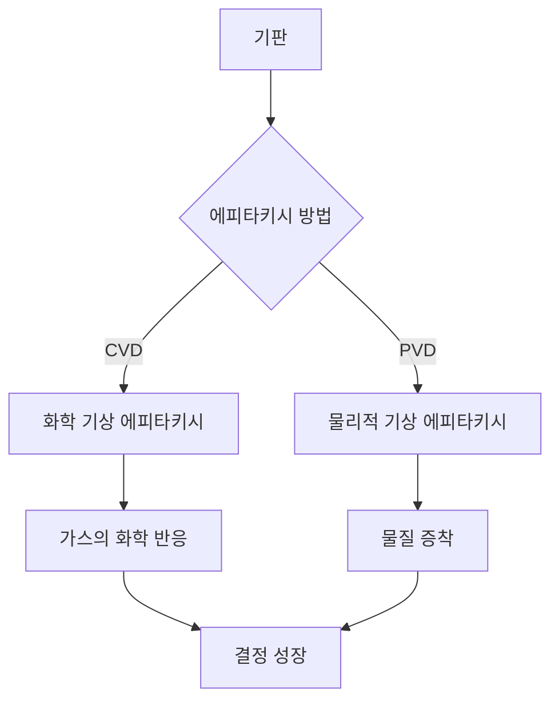

### 인용구 요약
에피타키시는 반도체 제조에서 결정 구조가 이미 형성된 기판 위에 새로운 결정 구조를 성장시키는 기술입니다. 이 과정은 고품질의 결정체를 생성할 수 있어 반도체 소자의 성능을 극대화하는 데 기여합니다.

### 딥다이브 원리

에피타키시는 크게 두 가지 방법으로 나눌 수 있습니다: 화학 기상 에피타키시(Chemical Vapor Epitaxy, CVD)와 물리적 기상 에피타키시(Physical Vapor Epitaxy, PVD). 아래는 이 두 가지 방법의 기본 메커니즘을 시각화한 Mermaid 다이어그램입니다.

#### 에피타키시의 종류

| 종류                | 설명                                                        | 장점                                     | 단점                                  |
|-------------------|-----------------------------------------------------------|----------------------------------------|-------------------------------------|
| 화학 기상 에피타키시 (CVD) | 기체 상태의 전구체가 화학 반응을 통해 고체 상태로 변환되어 결정이 성장함 | 균일한 두께, 고품질 결정 생성               | 높은 온도 필요, 복잡한 장비 필요           |
| 물리적 기상 에피타키시 (PVD) | 물질이 기화되어 기판에 물리적으로 증착됨                    | 저온 공정 가능, 다양한 물질 사용 가능      | 두께 균일성 문제, 낮은 성장 속도              |

### 에피타키시 공정 단계

1. **기판 준비**: 에피타키시를 수행할 기판을 선택하고 세척하여 표면을 평탄하게 만듭니다.
2. **환경 조절**: 반응이 이루어질 환경(온도, 압력, 기체 조성 등)을 설정합니다.
3. **전구체 주입**: CVD의 경우, 가스 상태의 전구체를 반응 챔버에 주입합니다.
4. **결정 성장**: 전구체가 화학 반응을 통해 기판 위에 결정이 성장합니다.
5. **후처리**: 성장된 결정체의 품질을 높이기 위해 열처리 등의 후처리를 수행합니다.

### 결론
에피타키시는 반도체 제조에서 필수적인 기술로, 고품질의 결정체를 생성하는 데 중요한 역할을 합니다. CVD와 PVD 각각의 방법은 특정한 장점과 단점을 가지고 있어, 응용 분야에 따라 적절한 방법을 선택하는 것이 중요합니다. 향후 반도체 기술의 발전과 함께 에피타키시 기술도 더욱 발전할 것으로 기대됩니다.
