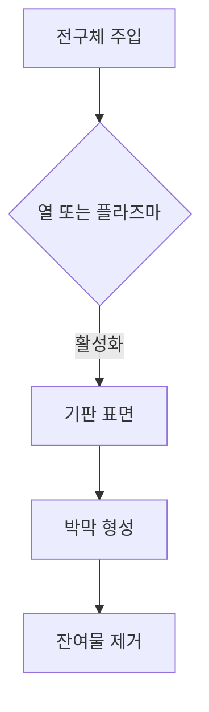

반도체 제조 공정 중 화학 기상 증착(CVD, Chemical Vapor Deposition)은 고품질의 박막을 형성하기 위해 널리 사용되는 기술입니다. 이 과정은 기체 상태의 전구체가 반응하여 고체 상태의 물질로 변환되는 화학 반응을 기반으로 합니다. CVD 공정은 반도체 소자의 전기적 특성을 결정짓는 중요한 단계이며, 다양한 재료와 응용 분야에 적합합니다.

## 1. CVD의 원리

CVD 공정은 일반적으로 다음과 같은 단계로 진행됩니다:

1. **전구체 주입**: 반응기 내부에 기체 상태의 전구체를 주입합니다.
2. **열 또는 플라즈마 활성화**: 전구체는 열 또는 플라즈마를 통해 활성화되어 반응을 시작합니다.
3. **박막 형성**: 활성화된 전구체가 기판 표면에 반응하여 고체 상태의 박막을 형성합니다.
4. **잔여물 제거**: 반응 후 남은 기체 또는 고체 잔여물을 제거합니다.

이 과정은 다음과 같은 화학 반응 메커니즘을 통해 진행됩니다:

## 2. CVD의 종류

CVD에는 여러 가지 변형이 있으며, 각 변형은 특정 응용에 적합합니다. 다음 표는 주요 CVD의 종류와 특징을 정리한 것입니다.

| CVD 종류         | 특징                                        | 응용 분야                        |
|------------------|-------------------------------------------|----------------------------------|
| 저압 CVD (LPCVD) | 낮은 압력에서 진행되어 균일한 박막 형성 | 반도체 소자, MEMS                |
| 고압 CVD (HPCVD) | 높은 압력에서 진행되어 빠른 성장 속도   | 대형 웨이퍼, 태양광 패널         |
| 플라즈마 보조 CVD | 플라즈마를 이용하여 낮은 온도에서 진행 | OLED, 나노소재                    |
| 원자층 증착 (ALD) | 원자 단위로 박막 형성                   | 고급 반도체 소자, 나노복합재료  |

## 3. CVD 공정의 장점과 단점

CVD 공정은 여러 가지 장점과 단점을 가지고 있습니다.

### 장점
- **균일한 박막 형성**: 기판의 모든 부분에 균일하게 박막을 형성할 수 있습니다.
- **높은 순도**: 고순도의 재료를 사용할 수 있어 전기적 특성이 우수합니다.
- **다양한 재료**: 실리콘, 질화물, 산화물 등 다양한 재료를 사용할 수 있습니다.

### 단점
- **비용**: 장비와 공정이 복잡하여 초기 투자 비용이 높습니다.
- **잔여물 문제**: 반응 후 남은 잔여물이 품질에 영향을 미칠 수 있습니다.
- **온도 민감성**: 고온에서 진행되므로 기판 손상 위험이 있습니다.

## 4. 결론

화학 기상 증착(CVD)은 반도체 제조에 필수적인 공정으로, 다양한 응용 분야에서 그 중요성이 증가하고 있습니다. 각종 CVD의 변형은 특정 요구사항에 맞춰 최적화할 수 있으며, 이를 통해 고품질의 반도체 소자를 생산할 수 있습니다. 앞으로도 CVD 기술은 반도체 산업의 발전과 함께 지속적으로 진화할 것으로 기대됩니다.