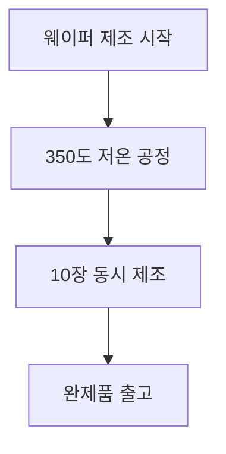

## 서론
반도체 산업은 현대 기술의 근본적인 기초가 되며, 지속적인 혁신이 요구되는 분야입니다. 최근 개발된 차세대 2차원 반도체 공정 기술은 반도체 제조의 효율성을 크게 향상시키고 있습니다. 특히, 한 번에 10장의 웨이퍼를 제조할 수 있는 기술은 생산성을 극대화하는 데 중요한 역할을 하고 있습니다. 본 포스팅에서는 이러한 기술의 배경, 공정 메커니즘 및 장단점을 상세히 살펴보겠습니다.

## 본론

### 공정 기술 개요
2차원 반도체는 기존의 3차원 반도체에 비해 더 얇고, 경량이며, 전기적 성질이 우수합니다. 이러한 특성 덕분에 전자기기에서의 응용 가능성이 높아지고 있습니다. 특히, 웨이퍼를 한 번에 10장씩 제조할 수 있는 기술은 제조 공정의 효율성을 비약적으로 향상시킵니다.

### 공정 메커니즘
차세대 2차원 반도체 공정은 여러 단계로 구성됩니다. 주요 단계는 다음과 같습니다:

1. **재료 선택**: 2차원 반도체에 적합한 재료를 선택합니다. 일반적으로 MoS2, WS2와 같은 전이금속 디칼코게나이드(TMDCs) 계열의 물질이 사용됩니다.
2. **웨이퍼 형성**: 선택된 재료를 이용하여 웨이퍼를 형성합니다. 이 과정에서 저온에서의 화학 기상 증착(CVD) 기술이 활용됩니다.
3. **패터닝 및 식각**: 웨이퍼 위에 필요한 회로 패턴을 형성하기 위해 포토리소그래피와 식각 공정이 적용됩니다.
4. **전기적 특성 테스트**: 완성된 웨이퍼의 전기적 특성을 테스트하여 성능을 검증합니다.

### 소재 특성 비교

| 소재         | 전기적 전도도 | 열 전도도 | 응용 분야          |
|--------------|----------------|-----------|---------------------|
| MoS2 | 높음           | 중간      | 트랜지스터, 센서   |
| WS2 | 매우 높음      | 높음      | 메모리, 광전자기기 |
| Graphene     | 매우 높음      | 매우 높음 | 전자기기, 배터리   |

### 장단점 분석
차세대 2차원 반도체 공정의 장단점은 다음과 같습니다:

- **장점**:
  - 높은 생산성: 한 번에 10장을 제조함으로써 생산 비용이 절감됩니다.
  - 우수한 성능: 2차원 구조로 인해 전기적 성능이 향상됩니다.
  - 다양한 응용 가능성: 전자기기, 센서 등 다양한 분야에서 활용될 수 있습니다.

- **단점**:
  - 초기 투자 비용: 새로운 공정 기술 도입에 따른 초기 투자 비용이 발생합니다.
  - 기술적 복잡성: 저온에서의 공정 관리가 필요하여 기술적 도전이 존재합니다.

> "반도체 산업의 혁신은 지속적인 연구 개발과 기술적 진보에 달려있다."

## 결론
차세대 2차원 반도체 공정 기술은 반도체 제조의 새로운 패러다임을 열고 있습니다. 특히, 한 번에 10장의 웨이퍼를 제조할 수 있는 기술은 생산성을 극대화하고, 전기적 성능을 향상시키는 데 기여하고 있습니다. 그러나 이러한 혁신은 초기 투자 비용과 기술적 복잡성을 동반하므로, 지속적인 연구와 개발이 필요합니다. 앞으로의 반도체 산업은 이러한 기술적 진보를 통해 더욱 발전할 것으로 기대됩니다.