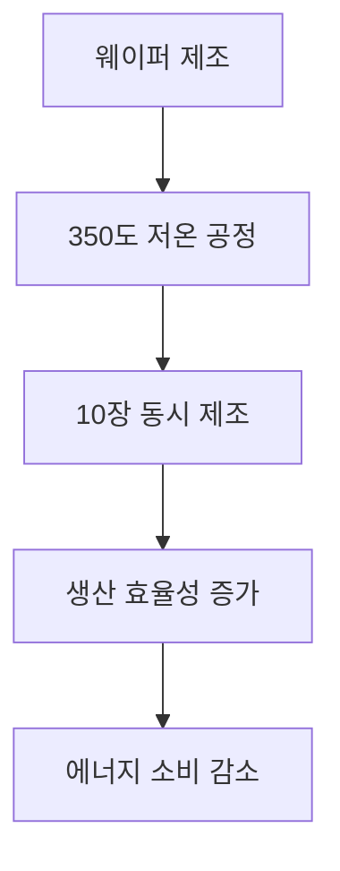

# 서론
반도체 산업은 현대 전자기기와 정보통신 기술의 핵심으로 자리잡고 있으며, 기술 발전에 따라 공정 기술 또한 지속적으로 진화하고 있습니다. 최근 평택시에서 시작된 반도체 소부장 기술검증 ‘오픈랩’ 가동과 같은 혁신적인 시도가 이루어지고 있으며, 이는 차세대 반도체 공정 기술의 발전을 가속화할 것으로 기대됩니다. 본 포스팅에서는 이러한 최신 기술 동향을 살펴보고, 그 의미와 향후 전망을 논의하겠습니다.

# 본론

## 1. 차세대 반도체 공정 기술
최근 반도체 공정 기술의 발전 중 가장 주목할 만한 점은 저온에서의 웨이퍼 제조 기술입니다. 재료연에서 개발한 350도 저온에서의 2차원 반도체 공정 기술은 한 번에 10장의 웨이퍼를 제조할 수 있는 가능성을 보여주고 있습니다. 이러한 기술은 생산 효율성을 크게 향상시키고, 에너지 소비를 줄이는 데 기여할 수 있습니다.

## 2. 텅스텐-질소 조합의 혁신
포스텍에서 연구된 텅스텐-질소 조합은 AI 메모리 반도체 공정의 새로운 가능성을 열었습니다. 이는 메모리 소자의 성능을 극대화하고, 생산 공정의 복잡성을 줄이는 데 기여할 수 있습니다. 이 기술은 AI 기반의 데이터 처리 능력을 향상시키는 데 중요한 역할을 할 것으로 기대됩니다.

## 3. 반도체 소재의 발전
반도체 공정에서 사용되는 소재는 성능과 생산성을 좌우하는 중요한 요소입니다. 최근 미국 반도체 소재 기업 그린트위드가 '외국기업의 날'에서 장관표창을 수상한 것은 이러한 소재 기술의 중요성을 다시 한번 일깨워 줍니다. 강문성 의원의 발언처럼, 국내 반도체 소재 산업의 발전을 위한 지원이 필요합니다.

| 소재 종류 | 특성 | 장점 | 단점 |
|------------|------|------|------|
| 실리콘(Si) | 전도성 | 널리 사용됨 | 고온에서 성능 저하 |
| 갈륨 비소(GaAs) | 고속 전도 | 높은 전송 속도 | 비쌈 |
| 탄화규소(SiC) | 내열성 | 높은 전압 내구성 | 제조 비용 높음 |
| 질화갈륨(GaN) | 고주파 특성 | 효율적 | 복잡한 제조 공정 |

## 4. 공정 경쟁력의 중심
한국의 반도체 산업은 최근 '회색지대 전략'을 통해 중국과의 경쟁에서 우위를 점하고 있습니다. 이는 반도체 공정 경쟁력을 높이는 데 중요한 요소로 작용하고 있으며, 특수가스와 같은 소재의 국산화가 그 중심에 있습니다. 이러한 전략은 한국의 반도체 산업을 더욱 견고하게 만들 것입니다.

> "반도체 공정 기술의 발전은 산업 전반에 걸쳐 큰 영향을 미치며, 특히 AI와 결합된 혁신이 기대된다."

# 결론
차세대 반도체 공정 기술의 발전은 단순한 기술 혁신을 넘어, 산업 전반에 걸쳐 큰 변화를 가져올 것으로 예상됩니다. 저온에서의 웨이퍼 제조, 텅스텐-질소 조합의 혁신, 그리고 소재 기술의 발전은 모두 반도체 산업의 미래를 밝히는 중요한 요소입니다. 이러한 기술들이 상용화되어 경쟁력을 갖춘 반도체 제품들이 시장에 출시된다면, 우리는 더욱 발전된 전자기기와 정보통신 기술을 경험할 수 있을 것입니다. 반도체 산업의 지속적인 발전을 위해서는 정부와 기업의 협력이 필수적이며, 이를 통해 한국이 글로벌 반도체 시장에서 선도적인 역할을 할 수 있기를 기대합니다.