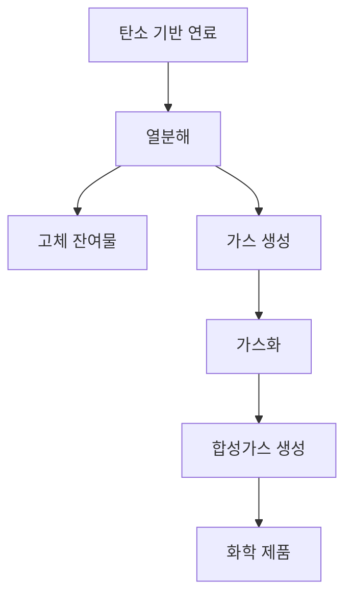

## 1. 개념 개요 (Overview)  
고온가스화 공정(High-Temperature Gasification Process)은 다양한 탄소 기반 연료를 고온에서 가스화하여 합성가스(Syngas)를 생성하는 화학 공정이다. 이 과정에서 생성된 합성가스는 메탄올, 암모니아, 수소 등 다양한 화학 제품의 원료로 사용될 수 있다. 고온가스화는 일반적으로 700°C에서 1,500°C의 온도 범위에서 진행되며, 이 과정에서 산소, 수증기 또는 이산화탄소와 같은 가스가 반응하여 고온의 가스 상태로 변환된다. 이 공정은 에너지 회수의 효율성을 높이고, 폐기물 관리 및 탄소 중립 목표 달성에 기여할 수 있는 중요한 기술로 주목받고 있다.

## 2. 핵심 작동 원리 (Mechanism)  
고온가스화 공정은 주로 두 가지 주요 반응으로 이루어진다: 열분해(Pyrolysis)와 가스화(Gasification). 이 두 과정은 서로 연결되어 있으며, 다음과 같은 메커니즘으로 설명할 수 있다.

1. **열분해**: 고온에서 탄소 기반 연료가 열에 의해 분해되어 고체 잔여물과 가스를 생성한다. 이 과정에서 발생하는 가스는 주로 수소, 메탄, 일산화탄소 등이다.
   
2. **가스화**: 생성된 가스가 산소, 수증기 또는 이산화탄소와 반응하여 합성가스를 형성한다. 이 과정은 열역학적 조건과 촉매의 존재에 따라 달라질 수 있다.

## 3. 공정 파라미터 및 주요 소재 (Materials & Variables)  
고온가스화 공정에서의 주요 파라미터와 소재는 다음과 같다.

| 파라미터            | 설명                                         |
|-------------------|--------------------------------------------|
| 온도 (Temperature) | 700°C ~ 1,500°C의 범위에서 조절됨               |
| 압력 (Pressure)   | 일반적으로 대기압 또는 고압에서 진행됨          |
| 반응물 (Feedstock)| 석탄, 바이오매스, 폐기물 등 다양한 탄소 기반 연료 |
| 산소 (Oxygen)     | 가스화 반응을 위한 산소 공급                     |
| 수증기 (Steam)    | 가스화 반응의 효율성을 높이기 위해 사용됨        |
| 촉매 (Catalyst)   | 반응 속도를 증가시키기 위해 사용될 수 있음      |

이러한 파라미터들은 공정의 효율성과 최종 제품의 품질에 큰 영향을 미친다. 예를 들어, 온도가 높을수록 가스화 반응 속도가 증가하지만, 동시에 고온에서의 장비 내구성 문제도 고려해야 한다.

## 4. 한계점 및 최신 기술 동향 (Trends & Challenges)  
고온가스화 공정은 여러 가지 장점이 있지만, 몇 가지 한계점과 도전 과제도 존재한다.

1. **한계점**:  
   - **고온 운영의 어려움**: 고온에서의 장비 내구성 문제와 에너지 소모가 크기 때문에 운영 비용이 증가할 수 있다.
   - **불완전한 가스화**: 반응 조건이 최적화되지 않으면 불완전한 가스화가 발생하여 합성가스의 품질이 저하될 수 있다.
   - **환경적 영향**: 고온가스화 과정에서 발생하는 CO2와 같은 온실가스의 배출 문제는 지속 가능한 발전을 위해 해결해야 할 과제이다.

2. **최신 기술 동향**:  
   - **촉매 개발**: 새로운 촉매의 개발을 통해 가스화 반응의 효율성을 높이고, 고온에서의 반응 속도를 증가시키는 연구가 활발히 진행되고 있다.
   - **폐기물 가스화**: 폐기물 처리와 에너지 회수를 동시에 해결하기 위한 폐기물 가스화 기술이 주목받고 있으며, 이를 통해 자원 순환 경제를 구현할 수 있다.
   - **탄소 포집 및 저장(CCS)**: 고온가스화 공정에서 발생하는 CO2를 포집하고 저장하는 기술이 발전하고 있으며, 이는 탄소 중립 목표 달성에 기여할 수 있다.

고온가스화 공정은 에너지와 화학 산업에서 중요한 역할을 하고 있으며, 지속 가능한 기술로 발전하기 위한 다양한 연구와 개발이 필요하다.