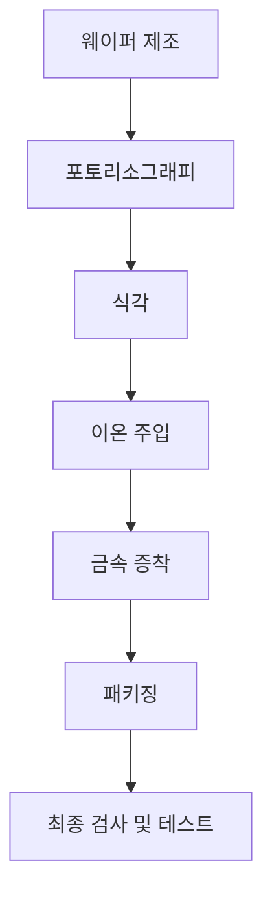

## 1. 개념 개요 (Overview)
반도체 제조 공정은 전자기기에서 필수적인 반도체 소자를 생산하기 위한 일련의 복잡한 과정이다. 이러한 과정은 주로 실리콘 웨이퍼를 기반으로 하며, 다양한 화학적 및 물리적 방법을 통해 전기적 특성을 조절하고 소자의 구조를 형성한다. 반도체 소자는 컴퓨터, 스마트폰, 가전제품 등 현대 전자기기의 핵심 부품으로, 그 제조 공정은 고도의 정밀성과 기술력을 요구한다.

반도체 제조 공정은 크게 웨이퍼 제조, 포토리소그래피, 식각, 이온 주입, 금속 증착, 패키징 등 여러 단계로 나눌 수 있다. 각 단계는 특정한 기술과 장비를 필요로 하며, 이들 간의 상호작용은 최종 제품의 성능과 품질에 직접적인 영향을 미친다.

## 2. 핵심 작동 원리 (Mechanism)

웨이퍼 제조는 고순도 실리콘을 크리스탈 형태로 성장시키는 과정으로 시작된다. 이 과정에서 실리콘 잉곳을 형성하고, 이를 얇게 절단하여 웨이퍼를 만든다. 다음 단계인 포토리소그래피에서는 빛을 이용하여 웨이퍼 표면에 패턴을 형성한다. 이 과정에서 감광제를 사용하여 특정 영역에만 빛을 노출시키고, 이후 화학적 처리를 통해 패턴을 고정한다.

식각 단계에서는 형성된 패턴에 따라 웨이퍼의 특정 부분을 제거하여 원하는 구조를 만든다. 이온 주입 과정에서는 불순물을 주입하여 반도체의 전기적 특성을 조절한다. 금속 증착 단계에서는 전극을 형성하기 위해 금속을 웨이퍼 표면에 증착한다. 마지막으로 패키징 단계에서는 소자를 보호하고 전기적 연결을 제공하기 위해 패키징을 진행한다.

## 3. 공정 파라미터 및 주요 소재 (Materials & Variables)

| 공정 단계       | 주요 소재           | 주요 파라미터                      |
|------------------|---------------------|-----------------------------------|
| 웨이퍼 제조      | 고순도 실리콘       | 온도, 압력, 성장 속도             |
| 포토리소그래피   | 감광제, UV 광원     | 노출 시간, 해상도, 패턴 크기     |
| 식각             | 화학 식각액         | 농도, 식각 시간, 온도            |
| 이온 주입        | 불순물 이온         | 이온 에너지, 주입 시간, 주입 농도 |
| 금속 증착        | 금속 (예: 알루미늄) | 증착 속도, 압력, 온도             |
| 패키징           | 패키징 재료         | 압력, 온도, 시간                  |

각 공정 단계에서 사용되는 소재와 파라미터는 반도체 소자의 성능에 큰 영향을 미친다. 따라서 각 단계에서의 최적화는 매우 중요하며, 이를 통해 고성능 반도체 소자를 제조할 수 있다.

## 4. 한계점 및 최신 기술 동향 (Trends & Challenges)
반도체 제조 공정은 고도로 발전하였지만 여전히 여러 한계점이 존재한다. 첫째, 공정의 복잡성으로 인해 생산 비용이 증가하고 있다. 특히, 최신 기술인 EUV(극자외선) 리소그래피와 같은 고급 기술의 도입은 초기 투자 비용이 매우 높아 경제적 부담이 크다.

둘째, 반도체 소자의 미세화가 진행됨에 따라 제조 공정의 정밀도가 더욱 요구되고 있다. 이는 생산 과정에서 발생할 수 있는 결함률을 낮추고, 고성능 소자를 생산하기 위한 필수 조건이다.

셋째, 환경 문제도 중요한 이슈로 부각되고 있다. 반도체 제조 과정에서 발생하는 화학물질과 에너지를 효율적으로 관리하고, 친환경적인 공정을 개발하는 것이 필요하다.

최신 기술 동향으로는 AI와 머신러닝을 활용한 공정 최적화, 새로운 반도체 소재 개발(예: GaN, SiC), 그리고 3D 반도체 구조의 연구가 활발히 진행되고 있다. 이러한 기술들은 반도체 제조 공정의 효율성을 높이고, 새로운 응용 분야를 개척하는 데 기여할 것으로 기대된다.
