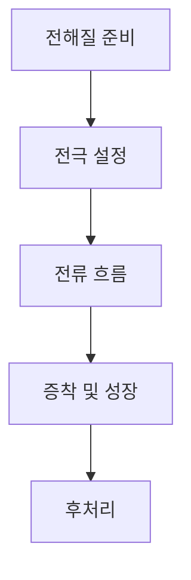

전기화학적 이온 증착(Electrochemical Deposition, ECD)은 전기화학적 반응을 이용하여 금속 또는 반도체 물질을 기판 위에 증착하는 공정이다. 이 공정은 전통적인 물리적 증착 방법과는 달리, 전기적 에너지를 사용하여 전해질 내의 이온을 환원시켜 기판에 물질을 형성하는 방식으로 진행된다. ECD는 미세 가공 및 나노 기술 분야에서 중요한 역할을 하며, 반도체 소자의 제조와 배터리, 태양 전지 등 다양한 응용 분야에서 활용된다.

### 인용구 요약
"전기화학적 이온 증착(ECD)은 전해질 내의 이온을 기판에 직접 증착시키는 혁신적인 기술로, 반도체 및 전자기기 제조에서 필수적인 역할을 한다."  

### 딥다이브 원리
ECD 공정은 다음과 같은 단계를 거쳐 진행된다:

1. **전해질 준비**: ECD 공정에 사용되는 전해질은 주로 금속 이온을 포함하고 있으며, 이는 증착할 물질에 따라 달라진다. 예를 들어, 구리(Cu) 증착을 위해서는 구리 이온(Cu2+)을 포함한 용액이 필요하다.

2. **전극 설정**: ECD 공정에서 기판은 음극으로 설정되며, 전해질 내에서 전류가 흐를 수 있도록 전극을 연결한다. 양극은 보통 불활성 전극으로 사용된다.

3. **전류 흐름**: 전류가 흐르면, 기판에서 금속 이온이 환원되어 고체 형태로 기판에 증착된다. 이 과정에서 전해질 내의 금속 이온 농도가 감소하며, 이온들이 기판 표면에 결합하게 된다.

4. **증착 및 성장**: 금속이 기판에 증착되면서 성장하게 되며, 이는 주로 전류의 세기와 전해질의 농도에 의해 조절된다. 적절한 조건에서 균일한 두께의 필름을 형성할 수 있다.

5. **후처리**: ECD 후에는 증착된 물질의 품질을 높이기 위해 열처리나 세척 과정을 거칠 수 있다. 이러한 후처리는 기판과의 결합력을 강화하고, 결함을 줄이는 데 기여한다.

이러한 과정을 다음과 같은 Mermaid 다이어그램으로 시각화할 수 있다:

### 한계 및 전망
전기화학적 이온 증착 공정은 여러 장점을 가지고 있지만, 몇 가지 한계 또한 존재한다. 첫번째로, ECD 공정은 전류 밀도와 전해질 농도에 매우 민감하며, 이 두 가지가 적절히 조절되지 않으면 불균일한 증착이나 결함이 발생할 수 있다. 두번째로, ECD는 주로 금속 또는 반도체에 국한되어 있으며, 다양한 재료에 대한 적용이 제한적일 수 있다.

향후 ECD의 발전 방향은 보다 다양한 재료의 증착 가능성과 공정의 자동화를 포함할 것이다. 특히, 나노 기술의 발전과 함께 ECD는 더욱 정밀한 증착 방법으로 자리 잡을 것으로 예상된다. 또한, 환경 친화적인 전해질 개발과 같은 지속 가능한 공정 개선이 이루어질 필요가 있다.

| 특성              | 값                        |
|-------------------|---------------------------|
| 전극 종류         | 음극 및 불활성 양극       |
| 전해질 조성       | 금속 이온 포함            |
| 전류 밀도         | 1 mA/cm² 이상 가능       |
| 증착 속도         | 수 nm/min ~ 수 μm/min    |
| 응용 분야         | 반도체, 배터리, 태양 전지 |

전기화학적 이온 증착(ECD)은 앞으로도 지속적으로 발전할 것으로 기대되며, 새로운 소재 및 기술의 융합을 통해 더욱 혁신적인 결과를 가져올 것이다.