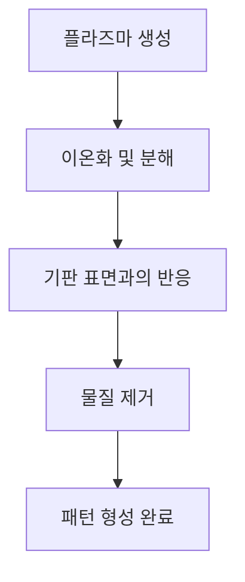

## 1. 개념 개요 (Overview)
플라즈마 에칭(Plasma Etching)은 반도체 제조 공정에서 중요한 역할을 하는 기술로, 주로 실리콘 웨이퍼와 같은 기판의 표면을 정밀하게 가공하는 데 사용된다. 이 공정은 화학적 반응과 물리적 작용을 결합하여 특정 패턴을 기판에 형성하는 과정이다. 플라즈마 상태에서의 반응은 높은 에너지의 이온과 중성 입자가 기판에 충돌하면서 발생하며, 이를 통해 원하는 물질을 선택적으로 제거할 수 있다. 플라즈마 에칭은 고해상도 패턴을 생성할 수 있어, 반도체 소자의 미세화와 성능 향상에 기여한다.

## 2. 핵심 작동 원리 (Mechanism)
플라즈마 에칭의 작동 원리는 다음과 같은 단계로 나눌 수 있다:

1. **플라즈마 생성**: 반응 가스를 전기적으로 이온화하여 플라즈마를 생성한다. 이 과정에서 고온의 전자와 이온이 발생한다.
2. **이온화 및 분해**: 플라즈마 상태에서 가스 분자가 이온화되거나 분해되어 반응성이 높은 이온과 중성 입자가 생성된다.
3. **기판 표면과의 반응**: 생성된 이온과 중성 입자가 기판의 표면에 충돌하여 화학적 반응을 일으킨다.
4. **물질 제거**: 반응 결과로 생성된 부산물이나 에칭된 물질이 기판에서 제거된다.
5. **패턴 형성 완료**: 최종적으로 원하는 패턴이 기판에 형성된다.

## 3. 공정 파라미터 및 주요 소재 (Materials & Variables)

| 파라미터          | 설명                                   | 주요 소재                   |
|-------------------|----------------------------------------|-----------------------------|
| 반응 가스         | 플라즈마 생성에 사용되는 가스         | SF6, Cl2, O2 |
| 압력              | 플라즈마 에칭 공정의 압력 수준       | 1 mTorr ~ 100 mTorr        |
| 전력              | 플라즈마를 생성하기 위한 전력        | 100 W ~ 1000 W             |
| 온도              | 기판의 온도                           | 20 °C ~ 80 °C              |
| 에칭 속도        | 물질 제거 속도                       | 50 nm/min ~ 500 nm/min     |
| 선택성            | 특정 물질을 선택적으로 에칭하는 비율 | SiO2 / Si       |

## 4. 한계점 및 최신 기술 동향 (Trends & Challenges)
플라즈마 에칭 기술은 반도체 제조에서 필수불가결한 과정이지만, 몇 가지 한계점이 존재한다. 첫째, 플라즈마 에칭 과정에서 발생하는 비균일한 에칭 속도는 패턴의 정밀도에 영향을 미칠 수 있다. 둘째, 에칭 부산물이 기판에 남아 있을 경우, 후속 공정에 악영향을 미칠 수 있다. 셋째, 플라즈마의 특성에 따라 특정 물질에 대한 선택성이 떨어질 수 있다.

최신 기술 동향으로는 고해상도 패턴을 형성하기 위한 새로운 가스 조합 및 공정 조건이 연구되고 있다. 또한, 인공지능(AI) 기반의 공정 최적화 기술이 도입되어 에칭 공정의 효율성과 정밀도를 높이는 데 기여하고 있다. 나노미터 수준의 정밀도를 요구하는 차세대 반도체 소자의 제조를 위해, 플라즈마 에칭 기술은 지속적으로 발전하고 있으며, 새로운 소재 및 공정 기술이 연구되고 있다.