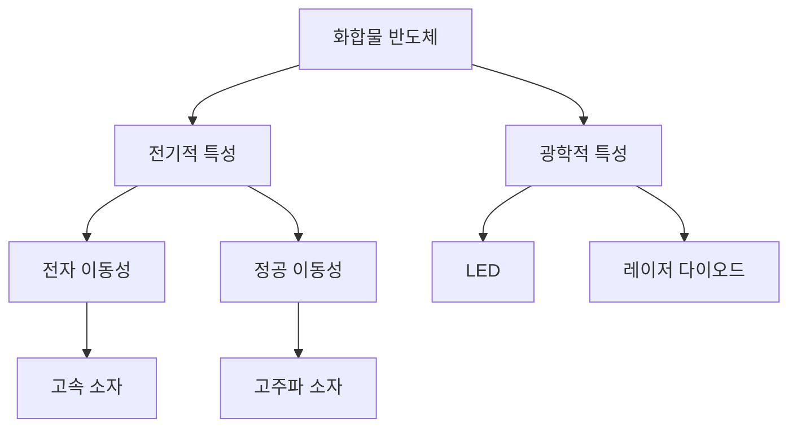

## 1. 개념 개요 (Overview)

화합물 반도체는 두 개 이상의 원소로 이루어진 반도체 재료로, 일반적으로 III-V족 원소(예: 갈륨, 인듐)와 VI족 원소(예: 셀레늄, 황)로 구성됩니다. 이들 반도체는 실리콘과 같은 전통적인 단원소 반도체에 비해 다양한 전기적, 광학적 특성을 가지며, 고속 전자 소자 및 광전자 소자에 널리 사용됩니다. 화합물 반도체는 LED, 레이저 다이오드, 고주파 소자 등에서 중요한 역할을 합니다.

## 2. 핵심 작동 원리 (Mechanism)

화합물 반도체의 작동 원리는 전자와 정공의 생성 및 재결합에 기반합니다. 이러한 재료는 에너지 밴드 구조가 복잡하여 전자 이동성이 높고, 다양한 밴드갭을 가질 수 있습니다. 이로 인해 특정 파장 범위의 빛을 방출하거나 전자 이동 속도가 빨라지는 등의 특성을 발휘합니다. 

## 3. 공정 파라미터 및 주요 소재 (Materials & Variables)
화합물 반도체의 제조 과정에서는 다양한 공정 파라미터와 소재가 사용됩니다. 아래 표는 주요 소재와 그 특성을 정리한 것입니다.

| 소재       | 화학식          | 밴드갭 (eV) | 용도                     |
|------------|-----------------|-------------|--------------------------|
| 갈륨 비소  | GaAs            | 1.42        | LED, 레이저 다이오드     |
| 인듐 인화물| InP             | 1.34        | 고주파 소자, 광통신      |
| 질화 갈륨  | GaN             | 3.4         | 고온 소자, LED           |
| 인듐 갈륨 비소 | InGaAs      | 0.75-1.7    | 적외선 감지기           |
| 질화 인듐  | InN             | 0.7         | 고속 전자 소자          |

## 4. 한계점 및 최신 기술 동향 (Trends)
화합물 반도체는 뛰어난 성능을 제공하지만, 몇 가지 한계점이 존재합니다. 첫째, 제조 비용이 높아 상용화에 어려움이 있으며, 둘째, 기계적 강도가 낮아 물리적 충격에 취약합니다. 셋째, 대량 생산 시 품질 관리가 어렵습니다. 

최신 기술 동향으로는 새로운 합성 방법과 나노 구조화 기술이 주목받고 있습니다. 예를 들어, 나노선(nanowire) 기술을 통해 고성능 소자를 개발하고 있으며, 2D 물질인 그래핀과의 결합을 통해 전자 소자의 성능을 극대화하는 연구도 진행되고 있습니다. 이러한 혁신들은 화합물 반도체의 응용 범위를 넓히고 있으며, 차세대 전자 및 광전자 소자의 발전에 기여하고 있습니다.