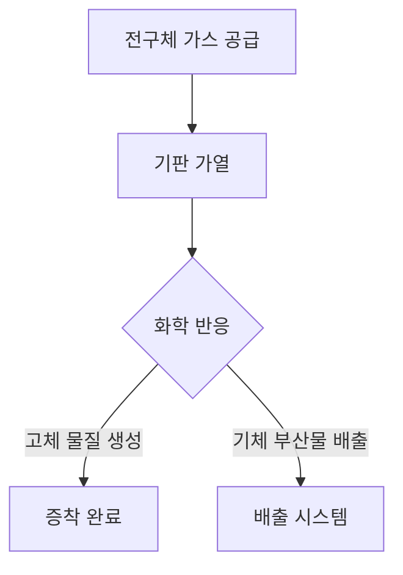

반도체 제조 공정에서 필수적인 요소 중 하나는 "화학 기상 증착(Chemical Vapor Deposition, CVD)"입니다. 이 공정은 반도체 소자의 특성과 성능을 결정짓는 중요한 단계로, 다양한 물질을 기판 위에 증착하여 원하는 두께와 구조를 형성하는 데 사용됩니다. CVD의 원리는 기체 상태의 전구체가 기판의 표면에서 화학 반응을 통해 고체 상태의 물질로 변환되는 것입니다. 이 과정은 고온에서 이루어지며, 다양한 화학 물질을 사용하여 반도체 소자의 다양한 층을 형성할 수 있습니다.

### 인용구 요약  
"화학 기상 증착(CVD)은 반도체 제조에서 필수적인 공정으로, 고품질의 박막을 형성하는 데 필수적이다." - 반도체 공정 전문가

### 딥다이브 원리  
CVD 공정의 기본 원리는 기체 전구체가 기판 표면에 도달하여 화학 반응을 일으키고, 이로 인해 고체 물질이 형성되는 것입니다. 이 과정에서 사용되는 전구체는 기체 상태에서 기판으로 전달되며, 기판의 온도와 압력에 따라 화학 반응이 조절됩니다. CVD는 다음과 같은 여러 가지 방식으로 진행될 수 있습니다:

1. **열 CVD (Thermal CVD)**: 기판을 고온으로 가열하여 전구체가 기판에서 분해되어 고체 물질로 변환됩니다.
2. **플라즈마 보조 CVD (Plasma-Enhanced CVD, PECVD)**: 플라즈마를 사용하여 반응 속도를 증가시키고, 저온에서 증착이 가능하게 합니다. 이는 열에 민감한 기판에 적합합니다.
3. **금속 유기 화학 기상 증착 (Metal-Organic CVD, MOCVD)**: 금속 유기 화합물을 전구체로 사용하여 반도체 소자에 필요한 금속 또는 합금을 증착합니다.

아래는 CVD 공정의 흐름을 나타낸 Mermaid 다이어그램입니다.

### 공정 스펙 비교표  
CVD의 다양한 방식에 따른 공정 스펙을 아래 표에 정리하였습니다.

| 공정 방식        | 특징                           | 장점                       | 단점                       |
|------------------|-------------------------------|----------------------------|----------------------------|
| 열 CVD           | 고온에서 진행                 | 높은 증착 속도             | 고온에 민감한 기판에 부적합 |
| 플라즈마 보조 CVD| 저온에서 진행 가능            | 열에 민감한 기판에 적합    | 플라즈마 장비의 복잡성     |
| 금속 유기 CVD    | 금속 유기 화합물 사용         | 높은 순도 및 결정성 확보    | 전구체의 안정성 문제       |

### 한계 및 전망  
CVD 공정은 반도체 제조에서 매우 중요한 역할을 하지만 몇 가지 한계점이 존재합니다. 첫째, 공정의 복잡성으로 인해 고비용의 장비와 운영이 필요합니다. 둘째, 특정 전구체의 독성 문제로 인해 안전 관리가 필요합니다. 셋째, 증착 두께의 균일성을 유지하기 어려운 경우가 있습니다. 이러한 한계에도 불구하고 CVD는 반도체 산업의 발전과 함께 지속적으로 발전하고 있으며, 특히 나노 기술과의 융합을 통해 새로운 가능성을 열어가고 있습니다.

미래의 CVD 기술은 더욱 정교한 공정 제어, 새로운 전구체의 개발, 그리고 다양한 기판에 대한 적용 가능성을 통해 반도체 소자의 성능을 더욱 향상시킬 것으로 예상됩니다. CVD는 반도체 제조의 핵심 공정으로 자리매김할 것이며, 앞으로의 기술 발전에 크게 기여할 것입니다.