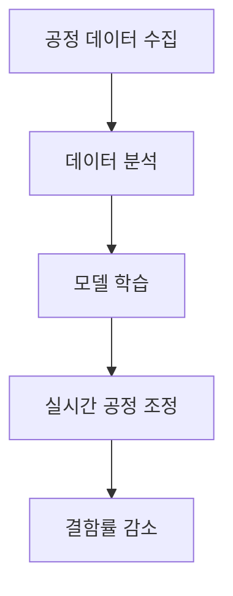

> **💡 오늘의 반도체 핵심 이슈와 기술적 인사이트를 정리한 리포트입니다.**

## 1. 📰 오늘의 핫이슈 (뉴스 요약 및 배경)

## 1. 📰 오늘의 핫이슈 (뉴스 요약 및 배경)

최근 반도체 산업은 여러 외부 요인에 의해 큰 변화를 겪고 있습니다. 특히 인공지능(AI) 기술의 발전과 이에 대한 투자가 급증하면서 반도체 수요는 증가세를 보였습니다. 그러나 최근 들어 AI 투자에 대한 위축이 감지되고 있습니다. 이는 여러 가지 이유로 설명될 수 있으며, 반도체 산업에 미치는 영향은 심각하게 고려해야 할 사항입니다.

우선, AI 기술의 발전과 함께 요구되는 반도체 성능은 날로 증가하고 있습니다. 데이터 처리 속도와 전력 효율성을 동시에 충족해야 하는 요구는 반도체 제조업체들에게 큰 도전과제가 되고 있습니다. 이러한 상황에서 주요 반도체 제조사들은 AI 전용 칩 개발에 집중하고 있으며, 이는 시장에서의 경쟁력을 높이는 핵심 요소로 작용하고 있습니다. 그러나 최근 몇 달 동안 AI 투자에 대한 불확실성이 커지면서 반도체 산업의 성장 전망도 함께 어두워지고 있습니다.

투자 위축의 원인은 여러 가지가 있습니다. 첫째, 글로벌 경제 불안정성이 주요 요인으로 작용하고 있습니다. 인플레이션 증가, 금리 인상, 공급망 문제 등은 기업들이 신규 프로젝트에 대한 투자를 주저하게 만드는 요소입니다. 둘째, 각국의 규제 강화도 중요한 변수입니다. 반도체 산업은 기술적 진보와 함께 국가 안보와 직결되는 분야로 인식되며, 이에 따라 각국 정부는 자국의 기술을 보호하기 위한 규제를 강화하고 있습니다. 이러한 규제들은 기업의 연구개발(R&D) 투자에 부담을 주며, 혁신을 저해하는 요소로 작용할 수 있습니다.

다음으로, 반도체 산업의 미래에 대한 불확실성은 기술 발전의 속도와도 밀접한 관계가 있습니다. AI 기술이 발전함에 따라 반도체의 설계 및 제조 공정 또한 혁신이 필요합니다. 그러나 이러한 혁신이 이루어지기 위해서는 막대한 자본과 시간이 소요됩니다. 현재의 투자 위축 상황에서 이러한 혁신이 이루어질 수 있을지에 대한 의문이 제기되고 있습니다.

마지막으로, 반도체 산업의 글로벌 경쟁이 심화되고 있습니다. 미국, 중국, 유럽 등 주요 경제권 국가들은 자국의 반도체 산업을 보호하고 육성하기 위해 정책을 강화하고 있습니다. 이러한 상황은 각국의 반도체 기업들이 서로 경쟁하는 환경을 조성하고 있으며, 이는 투자 결정을 더욱 복잡하게 만듭니다.

이러한 다양한 요인들이 복합적으로 작용하면서 AI 투자 위축은 반도체 산업의 미래에 큰 그림자를 드리우고 있습니다. 앞으로의 전망은 불확실하지만, 이러한 변화 속에서도 반도체 산업은 지속적으로 진화할 필요가 있습니다. 각 기업은 시장의 변화에 발맞추어 새로운 기술과 전략을 모색해야 할 것입니다.

---

## 2. 🔬 엔지니어의 시선: 기술 분석 (공정/소재 원리 딥다이브)

## 2. 🔬 엔지니어의 시선: 기술 분석 (공정/소재 원리 딥다이브)

반도체 산업의 미래를 논하기 위해서는 현재의 기술적 상황과 공정의 원리를 깊이 이해할 필요가 있다. AI 기술의 발전에 따른 반도체의 성능 요구 사항은 단순히 속도와 효율성을 넘어, 새로운 소재와 공정 기술의 도입을 필요로 한다. 이러한 변화는 특히 반도체 제조 공정의 각 단계에서 혁신을 요구하며, 이는 엔지니어들이 직면한 과제 중 하나이다.

### 2.1. 공정 기술의 진화

반도체 제조는 여러 단계로 구성되어 있으며, 각 단계는 고유한 기술적 도전 과제를 안고 있다. 일반적으로 다음과 같은 공정 단계로 나눌 수 있다.

| 공정 단계       | 설명                                  | 주요 기술 및 도전 과제                     |
|------------------|---------------------------------------|--------------------------------------------|
| 웨이퍼 제조      | 실리콘 웨이퍼를 생산하는 단계       | 고순도 실리콘, 결함 최소화                |
| 포토리소그래피   | 회로 패턴을 웨이퍼에 전사하는 단계  | 고해상도 리소그래피 기술, UV 노광 기술  |
| 식각            | 회로 패턴을 형성하기 위해 웨이퍼의 일부를 제거 | 선택적 식각 기술, 플라즈마 식각          |
| 이온 주입       | 도핑을 통해 반도체의 전기적 특성을 조절 | 이온 주입 기술, 에너지 조절               |
| 메탈화          | 전극을 형성하여 전기적 연결을 만드는 단계 | 고온 및 저온 메탈화 기술                  |

이러한 각 공정 단계는 반도체 소자의 성능 및 신뢰성에 직접적인 영향을 미친다. 특히, 포토리소그래피 공정에서의 해상도 향상은 더욱 미세한 회로 패턴을 실현하는 데 필수적이다. 최근에는 EUV(극자외선) 리소그래피 기술이 도입되어 7nm 이하의 공정 기술을 가능하게 하고 있으며, 이는 AI 칩의 복잡한 구조를 구현하는 데 중요한 역할을 한다.

### 2.2. 소재 혁신

반도체 소자의 성능을 극대화하기 위해서는 새로운 소재의 개발이 필수적이다. 현재 사용되는 실리콘 외에도, 다양한 반도체 소재들이 연구되고 있으며, 이들은 각각의 특성과 장점을 가지고 있다.

| 소재          | 특성 및 장점                               | 응용 분야                          |
|---------------|--------------------------------------------|-----------------------------------|
| 실리콘       | 안정성, 비용 효율성, 광범위한 활용       | 대부분의 반도체 소자              |
| GaN(질화갈륨)| 높은 전압 및 온도에서의 성능 우수       | 전력 반도체, RF 소자             |
| SiC(탄화규소)| 높은 열 전도성 및 내열성                  | 전력 전자 소자, 고온 환경        |
| 2D 소재      | 고전도성 및 유연성, 나노스케일 소자 가능  | 차세대 트랜지스터, 센서          |

이러한 소재들은 반도체 소자의 전력 효율성과 성능을 크게 향상시킬 수 있는 잠재력을 가지고 있다. 특히 GaN과 SiC는 전력 반도체에서의 응용이 증가하고 있으며, 이는 AI 연산에 필요한 높은 전력 효율성을 제공한다.

### 2.3. AI와 반도체 공정의 상관관계

AI 기술의 발전은 반도체 공정에도 많은 영향을 미치고 있다. AI는 데이터 분석 및 최적화에 있어 뛰어난 성능을 발휘하며, 이는 공정 제어 및 품질 관리를 혁신할 수 있는 가능성을 제공한다. 예를 들어, 머신러닝 알고리즘을 활용하여 공정 데이터를 분석하고, 이를 바탕으로 실시간으로 공정을 조정함으로써 결함률을 감소시킬 수 있다.

AI 기술을 활용한 공정 최적화의 예시는 다음과 같다.

이러한 접근 방식은 반도체 제조의 효율성을 극대화하고, 생산 비용을 절감하는 데 기여할 수 있다. 그러나 AI 기술을 효과적으로 통합하기 위해서는 고도의 데이터 인프라와 알고리즘 개발이 필요하다.

### 2.4. 규제와 기술 혁신의 균형

반도체 산업은 기술 혁신과 동시에 규제의 영향을 받는다. 각국 정부의 기술 보호 정책은 반도체 기업들에게 새로운 도전 과제가 되고 있다. 이러한 규제는 연구개발(R&D) 투자에 부담을 주며, 혁신의 속도를 저하시킬 수 있다. 따라서 기업들은 규제 환경을 고려하여 기술 개발 전략을 수립해야 하며, 이는 기업의 생존과 직결되는 문제이다.

결론적으로, 반도체 산업의 기술적 진화는 AI 기술의 발전과 밀접하게 연결되어 있으며, 새로운 소재와 공정 기술의 도입은 필수적이다. 엔지니어들은 이러한 변화에 발맞추어 혁신적인 솔루션을 모색해야 하며, 동시에 규제 환경을 고려한 전략적 접근이 필요하다. AI 투자 위축의 그림자 속에서도, 반도체 산업은 지속적으로 진화할 수 있는 가능성을 가지고 있다.

---

## 3. 💡 향후 전망 및 시사점 (시장 파급력)

## 3. 💡 향후 전망 및 시사점 (시장 파급력)

AI 투자 위축과 반도체 산업의 미래는 여러 복합적 요인에 의해 형성될 전망입니다. 이러한 변화는 단순히 기술적 진화에 그치지 않고, 시장의 구조와 경쟁 환경에도 심대한 영향을 미칠 것입니다. 특히, 규제 강화와 글로벌 경쟁의 심화가 반도체 산업의 성장 잠재력에 미치는 영향은 무시할 수 없는 요소입니다. 

### 3.1. AI 기술과 반도체 수요의 상관관계

AI 기술의 발전은 반도체 수요의 주요한 동력으로 작용해왔습니다. 하지만 최근 AI 투자에 대한 위축은 반도체 시장에 부정적인 영향을 미칠 가능성이 큽니다. AI 기술이 요구하는 고성능 반도체의 수요는 단기적으로 감소할 수 있으며, 이는 반도체 제조업체들의 매출 감소로 이어질 수 있습니다. 또한, AI 기술의 발전이 둔화됨에 따라 새로운 반도체 기술의 개발 필요성도 줄어들 수 있습니다. 

| 요인                      | 영향                                   |
|---------------------------|----------------------------------------|
| AI 투자 위축              | 반도체 수요 감소                      |
| 기술 발전 둔화           | 새로운 반도체 기술 개발 저해         |
| 글로벌 경제 불안정성      | 기업의 투자 결정에 부정적 영향       |

### 3.2. 규제의 영향과 기업 전략

각국 정부의 기술 보호 정책과 규제는 반도체 산업의 혁신을 저해할 수 있는 중요한 요소입니다. 이러한 규제가 강화되면, 기업들은 연구개발(R&D) 투자에 대한 부담이 커지고, 혁신의 속도가 느려질 수 있습니다. 특히, AI와 관련된 기술은 각국의 안보와 직결되는 분야로 간주되기 때문에, 규제의 영향이 더욱 두드러질 것입니다. 

기업들은 이러한 규제를 고려하여 전략을 수립해야 합니다. 예를 들어, 글로벌 시장에서 경쟁력을 유지하기 위해서는 자국 내 연구개발을 강화하고, 규제에 적합한 기술 개발에 집중해야 할 것입니다. 또한, 기업 간 협력을 통해 규제를 준수하면서도 기술 혁신을 도모할 수 있는 방안을 모색해야 합니다.

### 3.3. 글로벌 경쟁의 심화

미국, 중국, 유럽 등 주요 경제권 국가들은 자국의 반도체 산업을 보호하고 육성하기 위한 정책을 강화하고 있습니다. 이러한 경쟁은 반도체 기업들에게 새로운 도전 과제가 되고 있으며, 이는 투자 결정을 더욱 복잡하게 만들고 있습니다. 글로벌 경쟁이 심화됨에 따라, 기업들은 기술력과 생산성을 높이기 위한 전략적 투자가 필수적입니다.

| 지역        | 주요 정책 및 동향                      |
|-------------|---------------------------------------|
| 미국        | 반도체 산업 지원을 위한 보조금 및 세금 혜택 |
| 중국        | 자국 반도체 산업 육성을 위한 대규모 투자 |
| 유럽        | 반도체 자급자족을 위한 정책 강화       |

이러한 경쟁 환경 속에서 기업들은 차별화된 기술과 혁신적인 제품을 개발해야 할 뿐만 아니라, 효율적인 생산 공정을 구축하여 비용을 절감해야 합니다. 또한, 글로벌 공급망의 안정성을 확보하기 위해 다양한 전략적 파트너십을 구축하는 것이 중요합니다.

### 3.4. 미래의 기술 혁신과 지속 가능성

반도체 산업의 미래는 기술 혁신과 지속 가능성의 두 축을 기반으로 발전할 것입니다. AI 기술의 발전에 따라 새로운 반도체 소자의 요구 사항이 증가하고 있으며, 이는 기업들에게 기술 혁신의 필요성을 더욱 부각시키고 있습니다. 특히, 고온 및 고전압 환경에서의 성능을 요구하는 전력 반도체의 수요는 지속적으로 증가할 것으로 예상됩니다.

이와 함께, 반도체 산업은 환경 문제에 대한 대응도 고려해야 합니다. 지속 가능한 제조 공정과 친환경 소재의 개발은 기업의 경쟁력을 높이는 중요한 요소로 작용할 것입니다. 이러한 방향으로의 전환은 기업의 사회적 책임을 다하는 동시에, 소비자와 투자자에게 긍정적인 이미지를 제공할 수 있습니다.

### 3.5. 결론 및 시사점

결론적으로, AI 투자 위축과 반도체 산업의 미래는 서로 밀접하게 연결되어 있으며, 다양한 외부 요인들이 복합적으로 작용하고 있습니다. 기업들은 이러한 변화에 대응하기 위해 혁신적인 기술 개발과 효율적인 생산 공정을 구축해야 하며, 규제 환경을 고려한 전략적 접근이 필요합니다. 

앞으로의 반도체 산업은 기술 혁신과 지속 가능성을 중심으로 발전할 것이며, 이를 통해 새로운 시장 기회를 창출할 수 있을 것입니다. 따라서 기업들은 변화하는 시장 환경에 발맞추어 유연한 전략을 수립하고, 지속적인 투자와 혁신을 통해 경쟁력을 유지해야 할 것입니다. 이러한 접근이 반도체 산업의 지속적인 성장을 이끌어낼 수 있는 핵심 요소가 될 것입니다.

---

