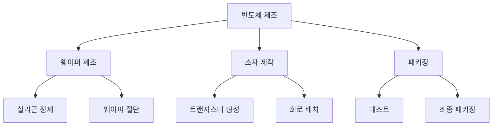

서론 요약:  
2023년 반도체 산업은 여러 도전과 기회를 맞이하고 있습니다. 특히, 한국과 미국 간의 세무조사 및 인센티브 사후검증이 투자 장벽으로 작용하고 있으며, AI 투자 위축에 대한 우려가 커지고 있습니다. 이러한 상황 속에서 반도체 산업의 지속 가능한 성장을 위해서는 규제 혁신과 함께 바이오 및 AI 분야의 연계가 필수적입니다. 본 브리핑에서는 최근의 주요 이슈들과 함께 반도체 산업의 향후 전망을 다루고자 합니다.

본론:  
최근 반도체 산업에 대한 여러 보도가 이어지고 있습니다. 미 반도체업계에서는 한국의 세무조사와 인센티브 사후검증이 투자에 부담을 주고 있다는 의견이 제기되었습니다. 이는 한국의 반도체 산업이 미국과의 경쟁에서 뒤처질 우려를 낳고 있습니다. 

또한, AI 투자에 대한 위축 가능성도 제기되고 있습니다. AI 기술이 반도체 산업과 밀접하게 연관되어 있는 만큼, AI 투자 감소는 반도체 시장에도 부정적인 영향을 미칠 수 있습니다. 다음은 반도체 산업의 주요 기술 및 공정에 대한 다이어그램입니다.

이와 같은 공정은 반도체의 성능과 품질을 결정짓는 중요한 단계입니다. 각 단계에서의 기술적 진보가 반도체의 효율성을 크게 향상시킬 수 있습니다.

다음으로, 반도체 관련 기술의 장단점을 비교한 표를 제시합니다.

| 기술/공정       | 장점                                       | 단점                                      |
|-----------------|------------------------------------------|------------------------------------------|
| 웨이퍼 제조     | 높은 생산성, 대량 생산 가능               | 초기 투자 비용이 큼                      |
| 소자 제작       | 소형화 및 고성능 가능                     | 공정이 복잡하여 품질 관리 어려움          |
| 패키징          | 다양한 형태로 제품화 가능                 | 패키징 리드타임이 길어질 수 있음         |
| AI 연계         | 데이터 분석 및 최적화 가능                | 기술 의존도가 높아질 수 있음             |
| 바이오 연계     | 새로운 시장 창출 가능                     | 규제 및 안전성 문제                       |

이 표에서 보듯이, 각 기술과 공정은 고유의 장점과 단점을 가지고 있으며, 이러한 요소들을 종합적으로 고려하여 전략을 세우는 것이 중요합니다.

결론:  
결론적으로, 현재 반도체 산업은 여러 도전 과제에 직면해 있지만, 동시에 새로운 기회도 존재합니다. 특히, AI와 바이오 분야와의 융합은 반도체 산업의 미래 성장 엔진으로 작용할 가능성이 큽니다. 그러나 이러한 기회를 살리기 위해서는 규제 혁신과 함께 지속적인 기술 개발이 필요합니다. 궁극적으로, 반도체 산업의 지속 가능한 발전을 위해서는 투자 환경 개선과 함께 인재 양성 및 협력 네트워크 구축이 필수적입니다. 한국의 반도체 산업이 글로벌 경쟁에서 우위를 점하기 위해서는 이러한 다각적인 접근이 필요할 것입니다.