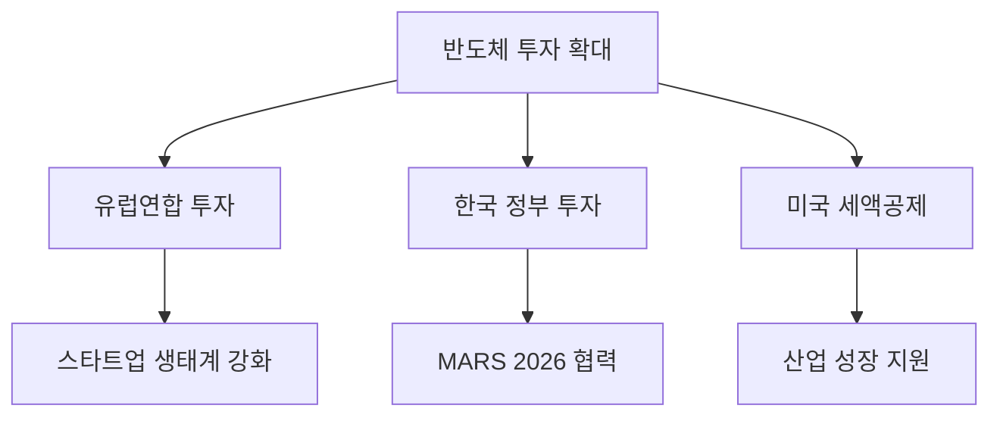

### 서론 요약  
최근 반도체 산업은 다양한 외부 요인으로 인해 혼란스러운 상황에 직면하고 있습니다. 글로벌 경제의 불확실성, 투자 한파, 그리고 기술 혁신의 필요성이 동시에 존재하는 가운데, 각국의 정부와 기업들이 반도체 산업에 대한 투자를 확대하고 있는 모습이 포착되고 있습니다. 본 브리핑에서는 최근 뉴스와 기사를 바탕으로 반도체 산업의 주요 이슈와 동향을 분석하고, 향후 전망에 대해 논의하고자 합니다.

### 본론  

#### 1. 투자 동향과 글로벌 시장 상황  
최근 보도에 따르면, 반도체 산업에 대한 투자가 증가하고 있으며, 특히 유럽연합은 반도체 스타트업에 7916억 원을 투자하여 설계 생태계를 강화하고 있습니다. 이러한 움직임은 반도체 산업의 경쟁력을 높이고, 유럽 내 반도체 생태계를 활성화하는 데 기여할 것으로 기대됩니다. 

또한, 전 세계 3분기 반도체 매출이 5000억 달러를 돌파하면서 AIDC(Artificial Intelligence Data Center) 투자가 반도체 수요를 견인하고 있다는 분석이 나왔습니다. 이러한 매출 증가세는 반도체 기술의 발전과 함께 시장의 수요가 증가하고 있음을 나타냅니다.

#### 2. 한국의 반도체 투자 계획  
한국에서도 반도체 투자에 대한 관심이 높아지고 있습니다. 정명근 화성시장은 반도체 투자협약과 공공 AI 혁신 성과를 통해 MARS 2026 글로벌 협력 확대를 강조했습니다. 이는 한국이 반도체 산업의 글로벌 리더로 자리매김하기 위한 전략의 일환으로 보입니다.

#### 3. 기업의 자본 배분 전략  
SK스퀘어는 4.3조 원 규모의 주주환원과 함께 AI 및 반도체 투자 병행을 통해 자본 배분 전략에 주목받고 있습니다. 이는 기업이 지속 가능한 성장을 위해 다양한 분야에 투자하고 있다는 점에서 긍정적인 신호로 해석됩니다.

#### 4. 미국의 반도체 지원 정책  
미국의 텍사스주에서는 반도체 지원이 지속될 것인지에 대한 우려가 제기되고 있습니다. 세액공제 연장이 변수로 작용할 가능성이 있으며, 이는 반도체 산업의 지속적인 성장을 위한 중요한 요소로 작용할 것입니다.

#### 5. 공정 및 소재 혁신  
최근 일본의 JIC가 JSR 미쓰이화학에 매각을 추진하고 있으며, 이는 반도체 소재 시장에서의 경쟁력을 높이기 위한 전략으로 볼 수 있습니다. 또한, 서울대 교수 창업 기업인 MSI가 반도체 공정용 멀티헤드 원자현미경을 개발하는 등, 기술 혁신이 계속해서 이루어지고 있습니다.

#### 다이어그램  

#### 6. 반도체 환경설비의 발전  
평택산업진흥원은 반도체 환경설비 오픈랩을 개소하여, 반도체 산업의 환경 문제를 해결하기 위한 노력을 기울이고 있습니다. 이는 반도체 산업의 지속 가능한 발전을 위한 중요한 이정표가 될 것입니다.

### 기술 스펙 및 장단점 비교  

| 기술/정책               | 장점                                   | 단점                                 |
|-----------------------|--------------------------------------|------------------------------------|
| 유럽연합의 스타트업 투자 | 생태계 강화, 혁신 촉진                     | 초기 투자 리스크 존재                     |
| 한국의 반도체 투자     | 글로벌 협력 증대, 기술력 향상               | 경쟁 심화로 인한 압박 증가                 |
| 미국의 세액공제 정책   | 기업 지원, 산업 성장 촉진                  | 정책 변경에 따른 불확실성 존재              |
| 반도체 환경설비 오픈랩 | 지속 가능한 발전, 환경 문제 해결              | 초기 투자 비용 증가 가능성                  |

### 결론  
반도체 산업은 현재 여러 가지 도전과 기회를 동시에 맞이하고 있습니다. 투자 한파 우려 속에서도 각국 정부와 기업들이 반도체 산업에 대한 투자를 지속적으로 확대하고 있는 점은 긍정적인 신호로 해석할 수 있습니다. 향후 기술 혁신과 공정 개선이 이루어질 것으로 예상되며, 이는 반도체 산업의 지속 가능한 성장을 위한 기반이 될 것입니다. 반도체 산업의 미래는 많은 변수에 의해 좌우되겠지만, 현재의 투자 및 혁신이 긍정적인 결과를 가져올 것이라는 점에서 기대가 큽니다.