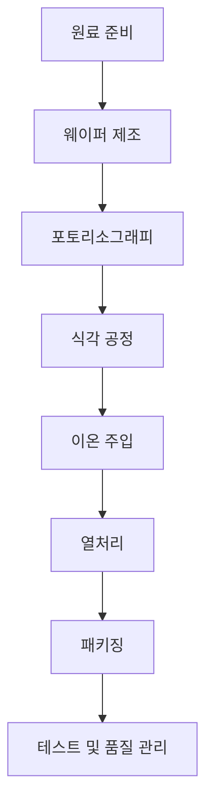

서론 요약:  
최근 반도체 산업은 전 세계적으로 큰 변화와 도전에 직면하고 있습니다. 글로벌 반도체 매출이 5000억 달러를 돌파한 가운데, 투자 한파와 관련된 우려가 커지고 있습니다. 이와 동시에 유럽연합은 반도체 스타트업에 대한 투자를 확대하여 설계 생태계를 강화하고 있으며, 한국과 중국에서도 반도체 산업에 대한 투자와 지원이 지속되고 있습니다. 이 브리핑에서는 현재의 반도체 투자 동향과 기술 발전을 살펴보고, 향후 전망을 제시하겠습니다.

본론:  
### 1. 반도체 투자 동향  
최근 발표된 여러 기사에 따르면, 반도체 산업에 대한 투자 동향은 두 가지 주요 축으로 나누어 볼 수 있습니다. 첫째, 글로벌 투자 감소에 대한 우려가 있으며, 둘째, 특정 지역 및 기업에 대한 집중적인 투자가 이루어지고 있다는 점입니다. 

#### 1.1 글로벌 투자 감소 우려  
MBC 뉴스에 따르면, 국내 코스피 지수가 매도 사이드카에 접어들며 반도체 산업에 대한 투자 심리가 위축되고 있습니다. 이는 전 세계적인 경기 둔화와 함께 반도체 수요의 변동성을 반영하는 것으로 볼 수 있습니다. 

#### 1.2 특정 지역 및 기업에 대한 집중 투자  
반면, 유럽연합은 7916억 원을 투자하여 반도체 스타트업의 설계 생태계를 강화하고 있습니다. 또한, SK스퀘어는 4.3조 원의 주주 환원과 함께 AI 및 반도체 분야에 대한 투자를 병행하고 있습니다. 이러한 투자는 반도체 산업의 경쟁력을 높이는 데 기여할 것으로 기대됩니다.

### 2. 기술 발전 및 혁신  
반도체 산업의 기술 발전은 매우 빠르게 진행되고 있으며, 새로운 제조 공정과 소재 개발이 활발히 이루어지고 있습니다. 

#### 2.1 차세대 반도체 제조 공정  
최근 기계연구원에서는 영하 120℃ 이하에서 작동하는 대용량 극저온 칠러를 개발하여 반도체 제조 공정의 효율성을 높이고 있습니다. 이는 반도체 제조 공정에서의 열 관리 기술을 혁신적으로 발전시키는 사례로 볼 수 있습니다.

#### 2.2 멀티헤드 원자현미경 개발  
서울대학교의 교수들이 창업한 MSI에서는 반도체 공정용 멀티헤드 원자현미경을 개발하였습니다. 이는 반도체 제조 공정의 정밀도를 높이고, 생산성을 향상시키는 데 크게 기여할 수 있는 기술입니다.

### 3. 다이어그램: 반도체 제조 공정 순서  

### 4. 기술 스펙 및 장단점 비교  

| 기술/소재          | 장점                             | 단점                             |
|--------------------|----------------------------------|----------------------------------|
| 극저온 칠러        | 효율적인 열 관리, 비용 절감 가능  | 초기 투자 비용이 높을 수 있음     |
| 멀티헤드 원자현미경 | 높은 정밀도, 생산성 향상         | 기술적 난이도, 유지보수 필요     |
| AI 기반 설계       | 자동화 및 최적화 가능            | 데이터 의존성, 초기 학습 기간 필요 |

결론:  
반도체 산업은 현재 투자 한파와 같은 어려움에 직면해 있지만, 동시에 기술 혁신과 지역별 집중 투자가 이루어지고 있습니다. 이러한 변화는 반도체 산업의 미래를 밝게 할 수 있는 기회로 작용할 것입니다. 특히, 새로운 제조 공정과 소재의 개발은 반도체 산업의 경쟁력을 높이는 데 중요한 역할을 할 것입니다. 앞으로의 반도체 시장은 더욱 복잡해지겠지만, 기술 혁신과 전략적인 투자로 인해 긍정적인 방향으로 나아갈 것으로 기대됩니다.