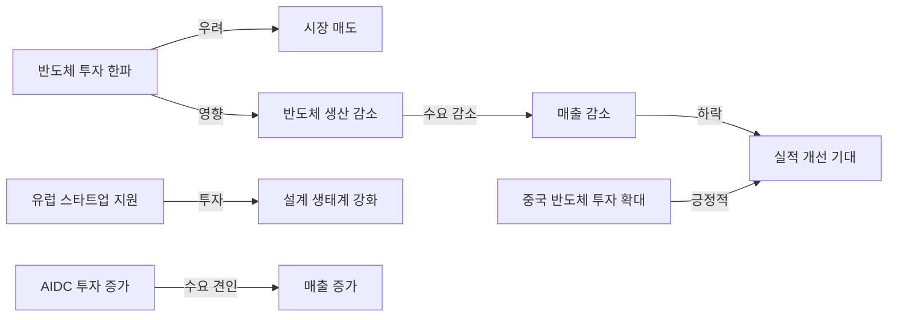

> 반도체 산업이 투자 한파에 직면하면서도 유럽연합의 스타트업 지원이 새로운 전환점을 마련하고 있습니다.  
> 전 세계 반도체 매출이 5000억 달러를 넘어섰으며, 이는 AIDC 투자의 수요 증가에 기인합니다.  
> 중국의 반도체 투자 확대가 하반기 실적 개선에 긍정적인 영향을 미칠 것으로 예상됩니다.  

## 📰 오늘의 반도체 핫이슈

최근 반도체 산업은 다양한 이슈로 인해 변화의 기로에 서 있습니다. 특히, 투자 한파가 우려되는 가운데 유럽연합이 반도체 스타트업에 7916억 원을 투자하여 설계 생태계를 강화하고 있습니다. 이는 반도체 산업의 혁신을 촉진할 것으로 기대되고 있습니다. 또한, 전 세계 반도체 매출이 5000억 달러를 돌파하며 AIDC(인공지능 데이터 센터) 투자가 수요를 견인하고 있습니다. 이러한 상황에서 중국의 반도체 투자 확대가 하반기 실적 개선에 기여할 것으로 보입니다.

## 🔬 엔지니어의 시선: 기술 분석

위의 다이어그램은 반도체 투자 한파와 유럽 스타트업 지원의 상관관계를 시각적으로 나타냅니다. 투자 한파는 시장의 매도를 초래하고, 이는 반도체 생산 감소로 이어지며 최종적으로 매출 감소를 유발합니다. 반면, 유럽의 스타트업 지원은 설계 생태계를 강화하여 반도체 산업의 혁신을 촉진합니다. AIDC 투자의 증가와 중국의 반도체 투자 확대는 이러한 흐름 속에서 긍정적인 영향을 미치고 있습니다.

## 💡 시장 전망 및 시사점
반도체 산업의 현재 상황은 다소 불확실성이 존재하지만, 유럽의 스타트업 지원과 AIDC 투자의 증가가 긍정적인 신호로 작용할 것으로 보입니다. 특히, 중국의 반도체 투자 확대가 하반기 실적 개선에 기여할 것으로 예상되며, 이는 글로벌 반도체 시장의 재편에 중요한 역할을 할 것입니다. 따라서 엔지니어 및 투자자들은 이러한 시장의 동향을 면밀히 관찰하고, 전략적인 투자 결정을 내리는 것이 필요합니다.