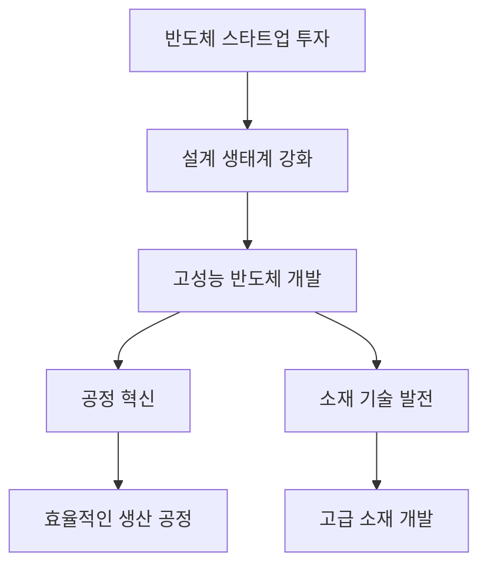

> 유럽연합, 반도체 스타트업에 7916억 원 투자.  
> 전 세계 3분기 반도체 매출 5000억달러 돌파.  
> SK스퀘어, AI·반도체 투자 병행 전략 주목.

## 📰 오늘의 반도체 핫이슈 (기사 바탕 동향 요약)
최근 유럽연합이 반도체 스타트업에 7916억 원을 투자하며 설계 생태계를 강화하고 있다는 소식이 전해졌습니다. 이러한 투자 전략은 유럽의 반도체 산업 경쟁력을 높이는 데 큰 역할을 할 것으로 예상됩니다. 또한, 전 세계 반도체 매출이 3분기 동안 5000억 달러를 돌파하며 AIDC(인공지능 데이터 센터) 투자가 수요를 견인하고 있는 것으로 나타났습니다. 이와 함께 SK스퀘어는 4.3조 원 규모의 주주환원과 함께 AI 및 반도체에 대한 투자를 병행하고 있어 자본 배분 전략에 대한 관심이 집중되고 있습니다.

## 🔬 엔지니어의 시선: 기술 분석
반도체 산업의 기술적 진화는 주로 공정 및 소재 혁신에 의해 주도되고 있습니다. 특히, 최근 반도체 설계 생태계의 강화는 고성능 반도체를 위한 새로운 공정 기술과 소재 개발에 크게 의존하고 있습니다. 

위 다이어그램은 반도체 스타트업에 대한 투자가 어떻게 설계 생태계를 강화하고, 이를 통해 고성능 반도체 개발로 이어지는지를 보여줍니다. 공정 혁신과 소재 기술 발전은 반도체의 성능을 높이는 데 필수적이며, 이는 결국 시장의 경쟁력을 강화하게 됩니다.

## 💡 시장 전망 및 시사점
반도체 시장은 현재 강력한 성장세를 보이고 있으며, 글로벌 투자은행들은 올해 성장률 전망을 3.7%로 상향 조정했습니다. 유럽연합의 스타트업 투자와 AIDC에 대한 높은 수요는 향후 반도체 산업의 지속 가능한 성장을 이끌 것으로 보입니다. SK스퀘어의 자본 배분 전략 또한 다른 기업들에게 긍정적인 영향을 미칠 것으로 예상됩니다. 따라서 반도체 산업의 기술 혁신과 투자 확대는 앞으로도 중요한 이슈로 부각될 것입니다.