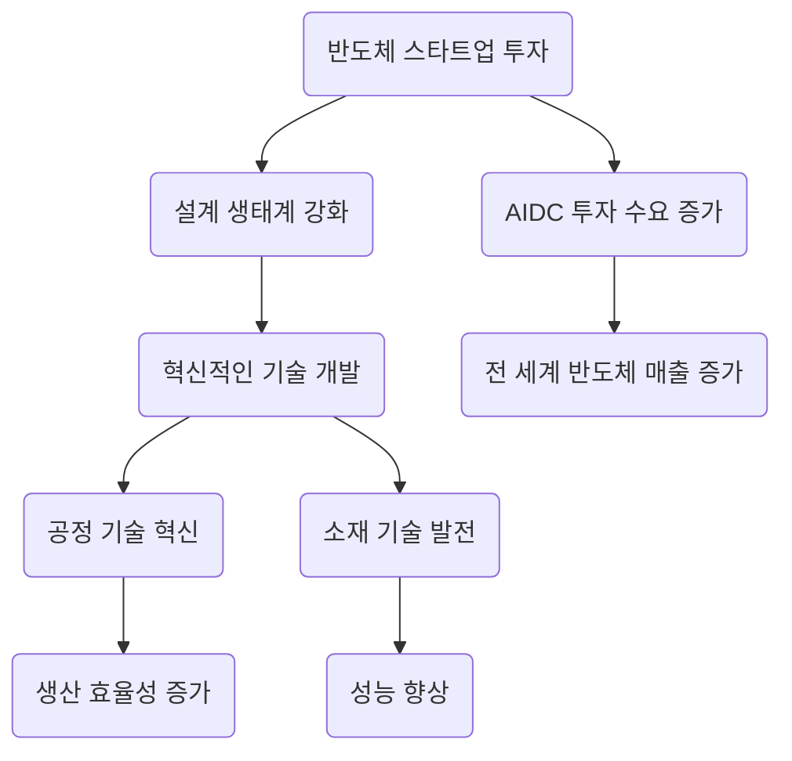

> 유럽연합이 반도체 스타트업에 대규모 투자를 단행하며 설계 생태계를 강화하고 있습니다.  
> 전 세계 반도체 매출이 5000억 달러를 돌파하며 AIDC 투자가 수요를 이끌고 있습니다.  
> 이러한 변화는 반도체 산업의 미래 성장 가능성을 높이며, 새로운 투자 기회를 창출할 것입니다.

## 📰 오늘의 반도체 핫이슈 (기사 바탕 동향 요약)
최근 유럽연합이 반도체 스타트업에 7916억 원을 투자하여 반도체 설계 생태계를 강화하겠다고 발표했습니다. 이는 유럽 내 반도체 산업의 경쟁력을 높이고, 혁신적인 기술 개발을 촉진하기 위한 전략으로 풀이됩니다. 또한, 전 세계적으로 3분기 반도체 매출이 5000억 달러를 돌파하며, AIDC(인공지능 데이터 센터) 투자가 반도체 수요를 견인하고 있는 상황입니다. 이러한 흐름 속에서 SK스퀘어는 주주환원과 함께 AI 및 반도체에 대한 투자를 병행하고 있으며, 향후 실적 개선이 기대되고 있습니다. 

## 🔬 엔지니어의 시선: 기술 분석
반도체 산업에서 최근의 투자 및 기술 발전은 공정 기술 및 소재의 혁신과 밀접한 관련이 있습니다. 유럽의 스타트업 투자는 새로운 설계 기술을 개발하는 데 기여할 것이며, 이는 다음과 같은 공정 및 소재 기술의 변화를 이끌어낼 것입니다.

이러한 흐름은 반도체 생산 과정에서의 효율성을 높이고, 새로운 소재 개발로 인해 성능이 향상될 것으로 기대됩니다. 특히, 2차원 반도체 웨이퍼의 동시 제작 기술은 생산 비용 절감 및 생산성 향상에 중요한 역할을 할 것입니다.

## 💡 시장 전망 및 시사점
반도체 산업의 투자 증가는 미래의 기술 혁신을 위한 토대를 마련하고 있습니다. 유럽연합의 스타트업 지원은 반도체 설계와 관련된 혁신을 가속화할 것으로 보이며, 이는 글로벌 시장에서의 경쟁력을 높이는 데 기여할 것입니다. 또한, AIDC 투자는 데이터 처리 및 저장의 효율성을 높여 더 많은 기업들이 AI 기술을 적용할 수 있는 기회를 제공할 것입니다. 

따라서, 반도체 산업의 성장과 함께 관련 기술의 발전에 주목할 필요가 있으며, 이는 투자자들에게 새로운 기회를 제공할 것입니다. 반도체 공정 및 소재 기술의 혁신은 앞으로의 산업 생태계에서 핵심적인 역할을 할 것으로 예상됩니다.