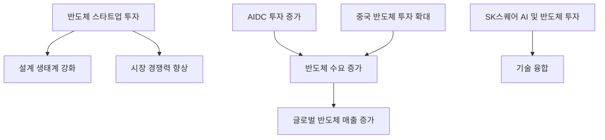

> 유럽연합의 반도체 스타트업에 대한 대규모 투자는 설계 생태계의 강화를 의미합니다.  
> 전 세계 반도체 매출은 AIDC 투자에 힘입어 5000억 달러를 넘어섰습니다.  
> 이러한 변화는 향후 시장 전망에 긍정적인 영향을 미칠 것으로 예상됩니다.  

## 📰 오늘의 반도체 핫이슈 (기사 바탕 동향 요약)
최근 유럽연합은 반도체 스타트업에 7916억 원을 투자하여 설계 생태계를 강화하는 조치를 취했습니다. 이는 유럽의 기술 자립을 위한 전략으로, 향후 반도체 산업의 경쟁력을 높이는 데 중요한 역할을 할 것입니다. 또한, 3분기 전 세계 반도체 매출이 5000억 달러를 돌파하며 AIDC(인공지능 데이터 센터) 투자가 수요를 견인하고 있다는 분석이 나왔습니다. 이러한 흐름 속에서 중국의 반도체 투자 확대가 기대되며, SK스퀘어는 AI 및 반도체 분야에 대한 투자를 병행하고 있습니다. 

한편, 심텍은 청주에 1천54억 원을 투자하여 반도체 수요 확대에 대비하고 있으며, 글로벌 투자은행들은 올해 성장률 전망을 3.7%로 상향 조정했습니다. 이러한 다양한 투자와 시장 변동은 반도체 산업의 긍정적인 성장 신호로 여겨집니다.

## 🔬 엔지니어의 시선: 기술 분석

위의 다이어그램은 반도체 스타트업에 대한 투자와 AIDC 투자가 반도체 수요 증가에 미치는 영향을 시각적으로 나타냅니다. 반도체 스타트업에 대한 투자는 설계 생태계를 강화하고, 이는 시장 경쟁력을 높이는 데 기여합니다. AIDC에 대한 투자는 추가적인 수요를 창출하며, 중국의 반도체 투자 확대는 이러한 추세를 더욱 가속화할 것으로 보입니다.

## 💡 시장 전망 및 시사점
현재 반도체 시장은 여러 가지 긍정적인 신호를 보이고 있습니다. 유럽연합의 스타트업 투자와 AIDC에 대한 투자는 향후 반도체 산업의 성장을 가속화할 것으로 예상됩니다. 또한, 중국의 반도체 투자 확대는 글로벌 시장에 긍정적인 영향을 미칠 것입니다. 이러한 변화는 반도체 산업의 경쟁력을 높이고, 기술 혁신을 촉진할 것으로 보이며, 엔지니어들은 이러한 트렌드를 반영하여 공정 및 소재 기술을 더욱 발전시켜 나가야 할 것입니다.