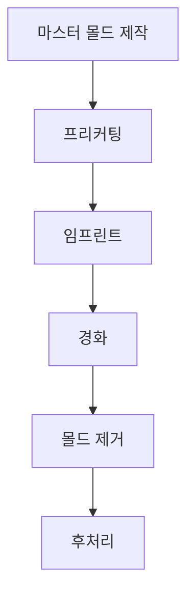

> **💡 나노임프린트 리소그래피(Nanoimprint Lithography) 공정에 대한 심층 딥다이브 문서입니다.**

## 1. 개념 개요 및 핵심 메커니즘

## 1. 개념 개요 및 핵심 메커니즘

나노임프린트 리소그래피(Nanoimprint Lithography, NIL)는 고해상도 패턴을 생성하기 위한 혁신적인 제조 기술로, 반도체, 광전자 및 나노기술 분야에서 널리 사용됩니다. 이 공정은 전통적인 포토리소그래피에 비해 비용 효율적이며, 더 작은 패턴을 생성할 수 있는 장점이 있습니다.

### 핵심 메커니즘

나노임프린트 리소그래피의 기본 원리는 다음과 같은 단계로 구성됩니다:

1. **마스터 몰드 제작**: 
   - 첫 번째 단계는 원하는 패턴을 가진 마스터 몰드를 제작하는 것입니다. 이 몰드는 일반적으로 실리콘 또는 금속으로 만들어지며, 고해상도의 패턴이 필요합니다.

2. **프리커팅(Pre-cutting)**:
   - 마스터 몰드의 표면에 고분자 물질(예: 폴리머)을 도포합니다. 이 고분자는 나노임프린트 리소그래피에서 패턴을 전사하기 위한 매개체 역할을 합니다.

3. **임프린트(Stamping)**:
   - 마스터 몰드를 고분자 층에 압착하여 패턴을 전사합니다. 이 과정에서 고분자는 마스터 몰드의 형상에 맞춰 변형되며, 패턴이 형성됩니다.

4. **경화(Curing)**:
   - 패턴이 전사된 후, 고분자는 열 또는 자외선(UV) 경화를 통해 경화됩니다. 이 단계에서는 고분자가 안정화되고, 패턴이 고정됩니다.

5. **몰드 제거(Removal)**:
   - 경화가 완료된 후, 마스터 몰드는 조심스럽게 제거됩니다. 이 과정에서 패턴이 고분자에 남아 있게 됩니다.

6. **후처리(Post-processing)**:
   - 필요에 따라 패턴을 추가적으로 가공하거나, 다른 재료로 코팅하여 원하는 특성을 부여할 수 있습니다.

### 공정 흐름도

### 나노임프린트 리소그래피의 장점

| 장점                       | 설명                                      |
|--------------------------|-----------------------------------------|
| 고해상도 패턴 생성         | 수십 나노미터 수준의 미세한 패턴 생성 가능 |
| 비용 효율성                | 전통적인 포토리소그래피에 비해 저렴한 비용 |
| 다양한 재료 호환성        | 다양한 고분자 및 기판에서 적용 가능      |
| 간단한 공정               | 복잡한 장비 없이도 공정 가능             |

이러한 메커니즘과 장점 덕분에 나노임프린트 리소그래피는 차세대 반도체 소자 및 나노구조의 제조에 중요한 역할을 하고 있습니다.

---

## 2. 주요 소재 및 공정 파라미터

## 2. 주요 소재 및 공정 파라미터

나노임프린트 리소그래피(NIL) 공정에서 사용되는 주요 소재와 공정 파라미터는 패턴의 품질과 성능에 큰 영향을 미칩니다. 이 섹션에서는 각 소재의 특성과 공정 파라미터의 중요성을 살펴보겠습니다.

### 2.1 주요 소재

1. **고분자 물질**
   - 고분자 물질은 나노임프린트 리소그래피에서 패턴을 형성하는 주재료입니다. 일반적으로 사용되는 고분자는 다음과 같습니다:
     - **PMMA (Polymethyl methacrylate)**: 높은 투명성과 우수한 해상도를 제공.
     - **UV 경화 고분자**: 자외선에 의해 경화되며, 빠른 경화 속도를 자랑.
     - **열경화성 고분자**: 열에 의해 경화되며, 높은 열적 안정성을 제공.
  
   | 고분자 종류         | 특성                                      | 용도                      |
   |------------------|-----------------------------------------|-------------------------|
   | PMMA             | 높은 해상도, 투명성                       | 고해상도 패턴 생성         |
   | UV 경화 고분자     | 빠른 경화 속도, 다양한 경화 조건 가능       | 고속 생산 및 다층 구조 제작 |
   | 열경화성 고분자    | 높은 열적 안정성, 기계적 강도                  | 고온 환경에서의 응용       |

2. **마스터 몰드 소재**
   - 마스터 몰드는 일반적으로 실리콘, 금속 또는 세라믹으로 제작됩니다. 각 소재의 특성은 다음과 같습니다:
     - **실리콘**: 높은 정밀도와 기계적 강도를 제공, 주로 반도체 제조에 사용.
     - **금속**: 높은 열전도성과 전기전도성을 제공, 전자 소자 제조에 적합.
     - **세라믹**: 높은 내열성과 화학적 안정성을 제공, 특수 응용 분야에서 사용.

   | 몰드 소재          | 특성                                      | 용도                      |
   |------------------|-----------------------------------------|-------------------------|
   | 실리콘           | 높은 정밀도, 기계적 강도                   | 반도체 소자 제조           |
   | 금속             | 높은 열전도성, 전기전도성                  | 전자 소자 및 회로 패턴    |
   | 세라믹           | 높은 내열성, 화학적 안정성                  | 특수 응용 및 환경 저항    |

### 2.2 공정 파라미터

1. **압력**
   - 임프린트 과정에서 적용되는 압력은 패턴의 전사 품질에 중요한 영향을 미칩니다. 적정 압력 범위는 고분자의 점도와 몰드의 형상에 따라 다르며, 일반적으로 1-10 MPa의 범위에서 조절됩니다.

2. **온도**
   - 고분자의 경화 온도는 공정 속도와 패턴의 안정성에 영향을 미칩니다. 일반적으로 100-200°C의 온도에서 경화가 이루어지며, 고분자의 종류에 따라 조정이 필요합니다.

3. **경화 시간**
   - 경화 시간은 고분자가 완전히 경화되기 위해 필요한 시간으로, 일반적으로 수 초에서 수 분까지 다양합니다. 이 시간은 고분자의 두께와 경화 조건에 따라 달라집니다.

4. **몰드 표면 처리**
   - 몰드의 표면 처리는 패턴 전사 과정에서 고분자의 접착력을 조절하는 데 중요한 역할을 합니다. 일반적으로 실리콘 표면에 실리콘 산화물(SiO₂) 또는 플루오로화합물로 처리하여 비접착성을 높입니다.

### 2.3 공정 최적화

NIL 공정의 최적화를 위해서는 위에서 언급한 소재 및 파라미터를 조절하는 것이 중요합니다. 이를 통해 패턴의 해상도, 정밀도, 생산성을 극대화할 수 있습니다. 공정 최적화를 위한 주요 고려 사항은 다음과 같습니다:

| 고려 사항               | 설명                                      |
|---------------------|-----------------------------------------|
| 고분자 선택            | 원하는 패턴 해상도와 경화 조건에 맞는 고분자 선택 |
| 압력 및 온도 조절       | 최적의 압력 및 온도 설정으로 패턴 품질 개선      |
| 경화 시간 최적화        | 경화 시간을 조절하여 생산성 향상               |
| 표면 처리 기술 개선      | 몰드 표면 처리를 통해 패턴 전사 효율성 증가      |

이러한 요소들을 종합적으로 고려하여 나노임프린트 리소그래피 공정을 최적화하면, 고해상도 및 고품질 패턴을 효과적으로 생성할 수 있습니다.

---

## 3. 기술적 한계점 및 향후 전망

## 3. 기술적 한계점 및 향후 전망

나노임프린트 리소그래피(NIL) 공정은 많은 장점을 가지고 있지만, 몇 가지 기술적 한계점이 존재합니다. 이러한 한계점은 향후 연구 및 개발 방향에 중요한 영향을 미치게 됩니다.

### 3.1 기술적 한계점

1. **패턴 전사 정확도**
   - 패턴 전사 과정에서 발생할 수 있는 왜곡 및 결함은 공정의 정확도에 큰 영향을 미칩니다. 특히, 고온 또는 고압 환경에서의 변형이 문제로 지적됩니다.

2. **대면적 패턴화**
   - 현재의 NIL 기술은 대면적 패턴화에 한계가 있으며, 이는 대량 생산에 적합하지 않을 수 있습니다. 특히, 패턴의 일관성을 유지하는 것이 도전 과제가 됩니다.

3. **고분자 특성의 한계**
   - 사용되는 고분자의 특성은 패턴의 해상도 및 경화 속도에 영향을 미치며, 특정 응용 분야에서는 원하는 특성을 충족하지 못할 수 있습니다.

4. **비용 문제**
   - 초기 투자 비용이 높은 편이며, 대량 생산을 위한 공정 최적화가 필요합니다. 이는 중소기업이나 스타트업에게는 부담이 될 수 있습니다.

### 3.2 향후 전망

향후 나노임프린트 리소그래피의 발전 방향은 다음과 같은 몇 가지 주요 분야로 나눌 수 있습니다:

1. **공정 개선 및 최적화**
   - 공정의 정확도를 높이기 위한 연구가 지속적으로 이루어질 것이며, 특히 패턴 전사 과정에서의 왜곡을 최소화하는 기술 개발이 필요합니다. 

2. **새로운 고분자 개발**
   - 고분자의 특성을 개선하고 새로운 재료를 개발하여, 다양한 응용 분야에 적합한 고분자를 찾는 노력이 진행될 것입니다. 예를 들어, 고온 환경에서도 안정성을 유지할 수 있는 고분자의 개발이 필요합니다.

3. **자동화 및 대량 생산 기술**
   - 자동화된 시스템과 대량 생산을 위한 기술이 발전하면서, NIL 공정의 상용화가 가속화될 것입니다. 이를 통해 생산성을 높이고 비용을 절감할 수 있는 가능성이 열립니다.

4. **융합 기술 적용**
   - 나노임프린트 리소그래피와 다른 기술(예: 3D 프린팅, 포토리소그래피 등)의 융합을 통해 새로운 응용 분야를 발굴하고, 기존의 한계를 극복하는 방향으로 연구가 진행될 것입니다.

5. **환경 친화적인 공정 개발**
   - 지속 가능한 제조 기술에 대한 관심이 높아짐에 따라, 환경 친화적인 고분자 및 공정 개발이 중요해질 것입니다. 이를 통해 나노임프린트 리소그래피의 적용 범위를 확장하고, 사회적 책임을 다할 수 있는 방향으로 나아갈 것입니다.

이러한 방향으로 나노임프린트 리소그래피 기술이 발전함에 따라, 반도체 및 나노기술 분야에서의 응용 가능성이 더욱 확대될 것으로 기대됩니다.

---

